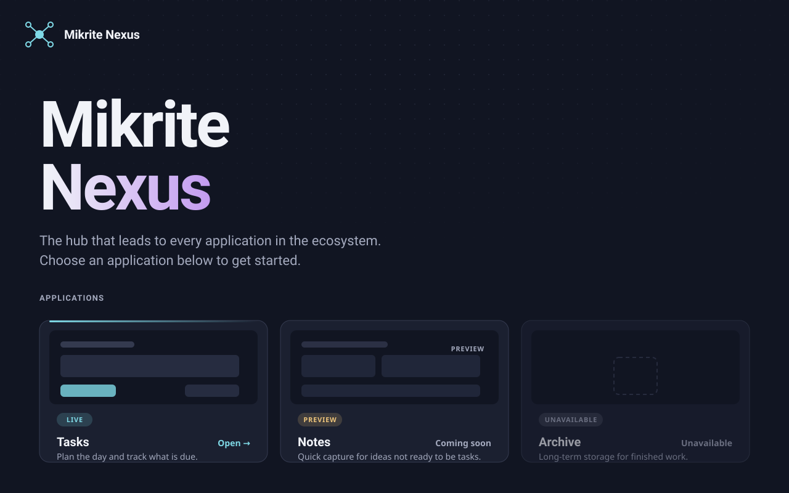

# Visual Design: Mikrite Nexus Front Page

**Date**: 2026-10-15 | **Plan**: [plan.md](plan.md) | **Research**: [research.md](research.md)

> **Superseded in part by [002-static-app-cards](../002-static-app-cards/spec.md) (2026-10-16).** The grid is designed for up to five applications, not 50. The visual system, card states and empty state are unchanged; the "constitution: 50+ apps" grid note is historical.

Goal: the page should look modern and fast, and not like a template. Speed comes from the
constraints (no framework, no web fonts, no images on the critical path). The modern look
comes from the tokens below, the hub motif and deliberate spacing.

## Preview

Desktop layout in the dark theme, showing all three card states. The sample applications
(Tasks, Notes, Archive) are placeholders. The file is [design-preview.svg](design-preview.svg).

Phone layout: the same cards stack into one column at 375 px with the 16 px gutter.

## Design concept: "a hub with spokes"

Nexus is a hub. The visual language follows that:

- A **node mark** (a small circle with radiating lines) appears in the header and as the
  favicon. It is inline SVG, not an image file.
- A faint **dot grid** sits behind the hero, fading out with a radial mask. It is pure CSS
  (`background-image` with radial gradients), so no request is needed.
- Application cards are **spokes**: each card has a thin accent line on its top edge that
  brightens on hover and focus.

The concept is deliberately simple. The look must be carried by the type scale, spacing and
color, not by decoration.

## Color tokens

Defined once in `src/input.css` as a custom daisyUI theme pair (`nexus-light` default,
`nexus-dark` with `prefersdark: true`). Tailwind's `@theme` exposes the non-colour tokens. Values use
`oklch()` for perceptually even steps; Tailwind v4 and the target browsers support it.

Each theme block also carries the two non-daisyUI tokens that change with the scheme, so no
separate media rules are needed:

- `--nexus-muted`: the muted text colour (table below).
- `--shadow-card`: subtle in light, `none` in dark.

Which theme applies is decided by daisyUI's `theme-controller` (see the theme switch below), not
by `prefers-color-scheme` alone.
daisyUI's stock themes are not used.

Token names below are the daisyUI names (`base-100`, `primary`, ...) mapped to the design
roles in the table.

| Design role | daisyUI token | Light | Dark | Use |
|---|---|---|---|---|
| Page background | `base-100` | `oklch(98% 0.005 265)` | `oklch(16% 0.02 265)` | Page |
| Card surface | `base-200` | `oklch(100% 0 0)` | `oklch(21% 0.025 265)` | Cards |
| Border | `base-300` | `oklch(90% 0.01 265)` | `oklch(32% 0.03 265)` | Card and divider borders |
| Text | `base-content` | `oklch(22% 0.03 265)` | `oklch(96% 0.01 265)` | Body and headings |
| Muted text | `base-content/70` | `oklch(48% 0.02 265)` | `oklch(74% 0.02 265)` | Descriptions, labels |
| Accent | `primary` | `oklch(52% 0.15 200)` | `oklch(80% 0.14 200)` | Focus ring, spoke line, links |
| Title gradient end | `secondary` | `oklch(50% 0.18 300)` | `oklch(76% 0.16 300)` | "Nexus" in title |
| Preview chip | `warning` | `oklch(55% 0.12 75)` | `oklch(82% 0.12 75)` | "Preview" status chip |
| Unavailable chip | `neutral` | `oklch(50% 0.02 265)` | `oklch(68% 0.02 265)` | "Unavailable" status chip |

**Contrast targets (WCAG 2.2 AA, verified in quickstart)**: body text 4.5:1 or higher on its
surface; large title and non-text UI (focus ring, card border) 3:1 or higher. The muted
token is the tightest; check it on both `--color-surface` and `--color-bg`. If it fails,
darken the light value by 2-3 lightness points rather than changing the hue.

## Typography

- Body and headings: `system-ui, -apple-system, "Segoe UI", Roboto, "Helvetica Neue", Arial, sans-serif`.
- Monospace (only for technical labels, if any): `ui-monospace, "Cascadia Code", Consolas, monospace`.
- Title: `clamp(2.5rem, 6vw + 1rem, 4.5rem)`, weight 750, line-height 1.02, letter-spacing `-0.035em`.
  The word "Nexus" uses a `linear-gradient` from `--color-text` to `--color-accent-2` via `background-clip: text`.
  Fallback: plain `--color-text` when `background-clip` is unsupported (use `@supports`).
- Description: `clamp(1.0625rem, 1rem + 0.3vw, 1.25rem)`, line-height 1.5, `--color-muted`, max 36 ch.
- Card title: 1.125rem, weight 650. Card description: 0.9375rem, line-height 1.5, `--color-muted`.
- Labels and chips: 0.75rem, weight 600, uppercase, letter-spacing `0.06em`.

## Spacing, radius and elevation

- Spacing scale (rem): 0.25, 0.5, 0.75, 1, 1.5, 2, 3, 4, 6. Defined as `--space-1` to `--space-9`.
- Page gutter: 1rem on phones (16px, required), 2rem from 768px, 3rem from 1200px.
- Max content width: 72rem.
- Radius: cards `1rem`; chips `999px`; focus ring `0.5rem`.
- Elevation: one shadow token, `--shadow-card`, subtle in light and none in dark (dark uses the border instead).

## Layout

- **Header**: node mark and wordmark "Mikrite Nexus" on the left, and the theme switch on the
  right. No navigation (the page is the hub; no nav is in scope). On phones the switch sits on
  the same row and must fit beside the wordmark at 375 px.
- **Theme switch**: a segmented control with two options, Light and Dark, in a `fieldset` with a
  visually hidden legend "Theme". Each option is a native radio input, so the arrow keys move
  between options. The checked option uses the `primary` fill; focus uses the standard focus ring
  on the option. Neither option is checked by default, so the page follows the device setting. In that state the option matching the device setting (Light on a light device, Dark on a dark device) is shown as active, so the visible selection always matches the theme in use.
- **Hero**: title, description, and a visible scroll cue only if the grid starts below the fold.
  The title and description must sit fully above the fold on 1280x720 and 375x667 (SC-002).
- **Application grid**: `display: grid` with
  `grid-template-columns: repeat(auto-fill, minmax(min(100%, 18rem), 1fr))` and `gap: var(--space-4)`.
  This gives one column on phones with no media query, and wraps without horizontal scroll
  for any number of apps (constitution: 50+ apps).
- **Card anatomy** (top to bottom): thumbnail area at 16:10 with `object-fit: cover`, status chip
  overlaid on the top-left, name, description clamped to 3 lines (`-webkit-line-clamp`), and a
  footer with the entry point label ("Open" for live, "Preview" for preview, "Unavailable" for unavailable).
- **Empty state**: a dashed-border panel, full grid width, with the text "No applications yet"
  and a one-line explanation. Same height rhythm as a card row so the page does not jump.
- **Footer**: below the grid, one line with "Copyright © {year} Mikrite" and the release version "v{version}". The year and version come from the build. Muted text, same gutters as the page.

## Card states

| State | Mock-up | Chip | Footer label | Activatable | Visual |
|---|---|---|---|---|---|
| `live` | The entry's own thumbnail (`thumbnail` file) | "Live" | "Open" | Yes (`<a>`) | Accent spoke on hover |
| `preview` | WebP thumbnail, lazy (the mock-up SVG is the reviewable source) | "Preview" | "Coming soon" | No (`aria-disabled`, still focusable) | Slightly dimmed mock-up; spoke stays muted |
| `unavailable` | Mock-up SVG or neutral placeholder | "Unavailable" | "Unavailable" | No | Muted border, no hover lift |

Per spec FR-008, switching from `preview` to `live` changes the chip, footer and link target.
It must not change card dimensions.

Unavailable entry with no mock-up: a neutral placeholder (dot grid plus the text "Preview not available") at the
same 16:10 size, so the layout does not break (spec edge case).

## Interaction and motion

- Hover on a live card: `hover:-translate-y-0.5 hover:border-primary`, spoke line to full width. 180 ms ease-out.
- Focus visible: `focus-visible:outline-2 focus-visible:outline-offset-3 focus-visible:outline-primary`. Never removed. Applies to both live and preview cards.
- Preview cards: focusable so keyboard users reach them, with `aria-disabled="true"`. Hover does not lift them.
- Motion: lift and transitions use `motion-safe:` variants so they are removed under `prefers-reduced-motion: reduce`; the focus ring is kept.

## Imagery: mock-ups

- Each mock-up is a 1600x1000 SVG viewBox, drawn with tokens-consistent colors (`currentColor` and a
  few fixed hues), showing the application's main screen as a simplified wireframe with a
  "Preview" watermark in the corner. No real screenshots of unbuilt applications.
- Keep under 4 KB each. No embedded raster images or fonts.
- Every card shows its own thumbnail in the same 16:10 area. Thumbnails are WebP, exported at 1280×800 pixels, with explicit `width` and `height` attributes to prevent layout shift. Thumbnails below the fold are lazy-loaded. No per-file size limit is set.
- `` is correct here because the card name already conveys the content. The
  preview label is in the chip text and read by screen readers.

## Accessibility

- Semantic structure: `<header>`, `<main>`, `<h1>` for the title, `<h2>` for the application section, a `<ul>` of cards with one `<li>` per app.
- Live cards are `<a>` elements whose accessible name is the app name.
- Preview and unavailable cards are plain focusable elements: a `
` with `tabindex="0"`, `aria-disabled="true"` and `aria-describedby` pointing to the status text. They have no link role and no `href`.
- Status is text, not color alone (the chip has a label).
- The theme switch is a labelled radio group. Its options have visible text ("Light", "Dark"),
  and the checked state is readable without colour.

## Brand (open)

No brand assets were provided. This design uses a placeholder node mark and a teal-violet
palette. Swap the token values in `:root` and the inline SVG mark when real assets exist; no
layout change is needed. This is an open question in [spec.md](spec.md).
